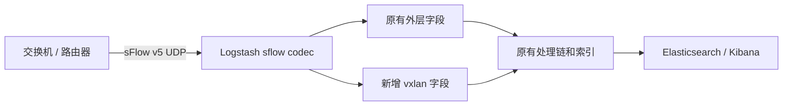
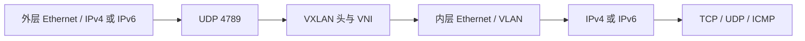
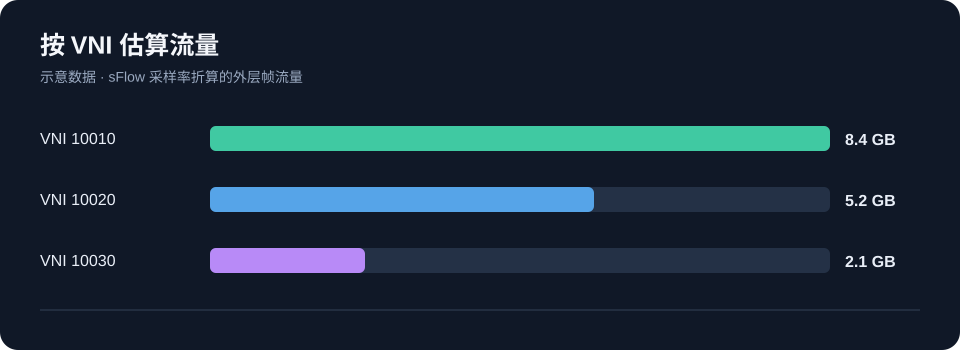
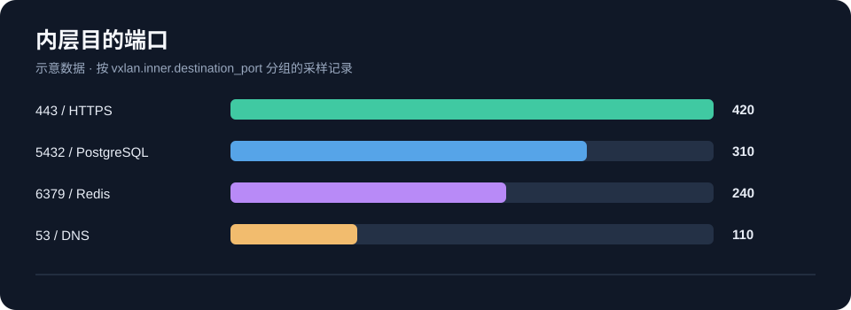
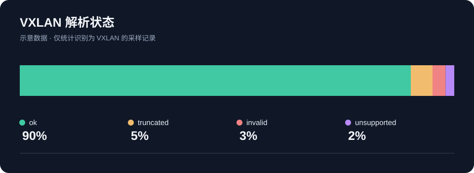

# sFlow VXLAN decoder for Logstash

给 `logstash-codec-sflow 2.1.3` 增加标准 VXLAN 解码。它从 sFlow v5 的原始采样报文头读取 VNI、VTEP 和内层五元组，原有外层字段和采样流量统计保持原样。适合继续使用 Logstash 版 ElastiFlow 的环境。



## 能解析什么



支持标准 UDP 目的端口 **4789**、VXLAN I 标志、24 位 VNI、内外层 IPv4/IPv6、最多两层 VLAN，以及内层 TCP/UDP 端口和 ICMP 类型。`vxlan.status` 区分 `ok`、`truncated`、`invalid`、`unsupported`。不做 IP 分片重组；非标准端口、GBP/GPE 和自定义 VXLAN 头暂不支持。设备必须把外层与内层头都纳入采样长度，建议从 192 或 256 字节开始检查。

| 字段 | 例子 |
| --- | --- |
| `vxlan.vni` | `10020` |
| `vxlan.outer.source_ip` | 外层 VTEP 地址 |
| `vxlan.inner.source_ip` | 内层源地址 |
| `vxlan.inner.destination_port` | 内层服务端口 |
| `vxlan.status` | `ok` |

## 使用

在已有 `logstash-codec-sflow 2.1.3` 的 Logstash 镜像上构建派生镜像：

```bash
docker build --build-arg BASE_IMAGE=robcowart/elastiflow-logstash:4.0.1 \
  -t logstash-sflow-vxlan:2.1.3 .
```

部署时用新镜像替换**现有 Logstash 容器的镜像**，保留原有环境变量、端口、pipeline、挂载和数据卷。Elasticsearch 与 Kibana 不需要重新部署。解码默认开启；如果 codec 配置中需要关闭，设置 `vxlan_enabled => false`。完整步骤见 [部署与验证](docs/deploy.md)。

构建会检查原版 `sflow.rb` 的 SHA256；基础镜像中的插件已被修改或版本不是 2.1.3 时会停止。已验证的组合是 ElastiFlow Logstash 4.0.1 与 Elasticsearch/Kibana 7.8.1。

## 可视化示例

下图使用本地合成 sFlow 流量演示 VNI、内层通信与解析质量；图中的数值只用于展示字段如何分析。仓库只提供解码功能，您可以在现有 Kibana 中按需制作图表。







采样字节与速率是按 sFlow 采样率估算的**外层帧流量**，不是应用载荷；记录数是采样数，不是连接数。不同 VNI 的相同内网 IP 应分别统计。

## 验证

本机使用原版 ElastiFlow Logstash 镜像构建，并在镜像内的 JRuby 运行测试：21 个解码用例、48 个断言全部通过；完整 codec 回放验证了普通流量、标准 VXLAN、截断样本、开关关闭、多个 sample 和 counter 路径。测试代码见 [`tests/`](tests/)。

## 许可

`codec/sflow.rb` 基于 Elasticsearch 发布的 `logstash-codec-sflow 2.1.3`，保留 Apache-2.0 许可和 NOTICE。本项目与 ElastiFlow 官方项目无隶属关系。
