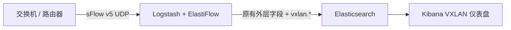
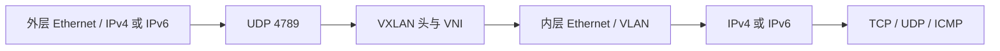
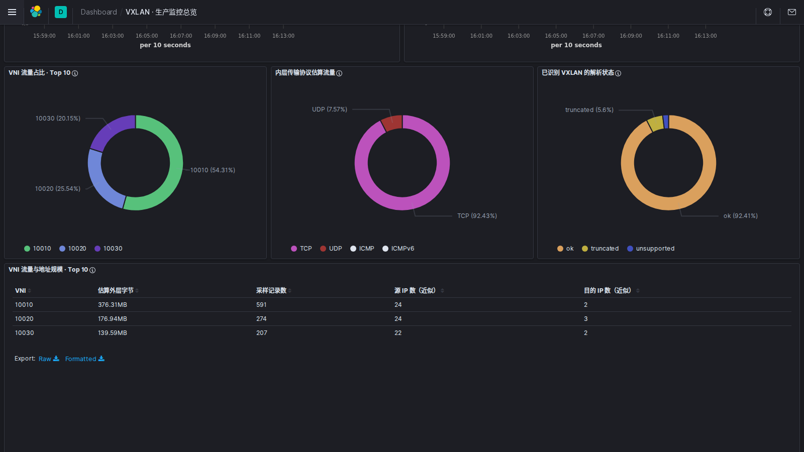
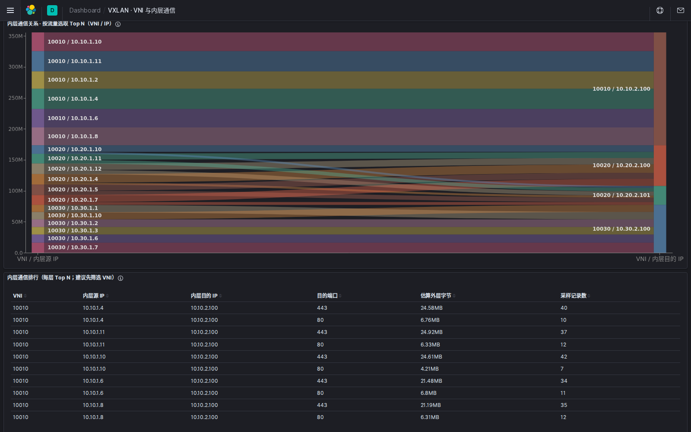
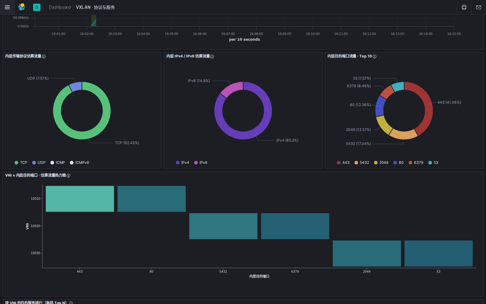
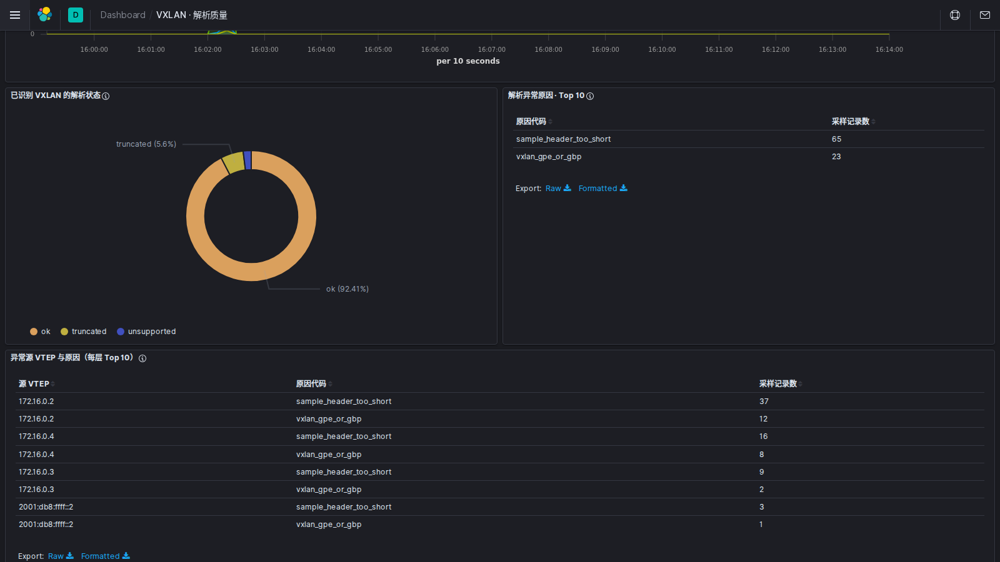

# ElastiFlow VXLAN

[ElastiFlow 旧版](https://github.com/robcowart/elastiflow/tree/v4.0.1)使用 Logstash 接收 NetFlow、sFlow 和 IPFIX，将流量记录写入 Elasticsearch，再由 Kibana 展示。本项目为其中的 **sFlow 采样报文**补充标准 VXLAN 解析，让现有系统除了外层 VTEP 流量，还能按 VNI、内层地址和服务端口查看通信。

仓库交付三个部分：`logstash-codec-sflow 2.1.3` 的解码补丁、合并 VXLAN 字段的 ElastiFlow 索引模板，以及可直接导入的 Kibana 图表。本项目是旧版 Logstash 方案的扩展，与 ElastiFlow 官方项目无隶属关系；新版 Unified Flow Collector 不在适用范围内。



## 能解析什么



支持标准 UDP 目的端口 **4789**、VXLAN I 标志、24 位 VNI、内外层 IPv4/IPv6、最多两层 VLAN，以及内层 TCP/UDP 端口和 ICMP 类型。`vxlan.status` 区分 `ok`、`truncated`、`invalid`、`unsupported`。不做 IP 分片重组；非标准端口、GBP/GPE 和自定义 VXLAN 头暂不支持。设备必须把外层与内层头都纳入采样长度，建议从 192 或 256 字节开始检查。

| 字段 | 例子 |
| --- | --- |
| `vxlan.vni` | `10020` |
| `vxlan.outer.source_ip` | 外层 VTEP 地址 |
| `vxlan.inner.source_ip` | 内层源地址 |
| `vxlan.inner.destination_port` | 内层服务端口 |
| `vxlan.status` | `ok` |

## 图表包

[`assets/kibana-7.8.1.ndjson`](assets/kibana-7.8.1.ndjson) 包含 **5 页仪表盘、53 个可视化、1 个异常明细搜索和 1 个索引模式**。页面覆盖流量总览、VNI 与内层通信、VTEP 与导出设备、协议与服务、解析质量。索引模式默认为 `elastiflow-4.0.1-*`，可按[部署文档](docs/deploy.md#导入-kibana-图表)导入已有 Kibana 7.8.1。

## 安装

已验证的组合是 ElastiFlow Logstash `4.0.1`、`logstash-codec-sflow 2.1.3`、Elasticsearch/Kibana `7.8.1`。已有三容器系统只需构建并切换 Logstash 镜像、更新当前索引映射、导入图表；ES/Kibana 容器与原有数据卷可继续使用。不需要 Docker Compose。

```bash
git clone https://github.com/blusssss/elastiflow-vxlan.git
cd elastiflow-vxlan
bash scripts/build-elastiflow.sh
```

构建脚本自动从原版镜像导出 ElastiFlow 索引模板，合并 VXLAN 映射，并生成 `elastiflow-vxlan:4.0.1`。接着按[手工部署与验收](docs/deploy.md)切换 Logstash 并导入 Kibana 图表。解码默认开启；如需关闭，可在 codec 配置中设置 `vxlan_enabled => false`。

使用其他已安装原版 sFlow codec 2.1.3 的 Logstash 镜像时，可单独使用 [`Dockerfile`](Dockerfile) 构建纯解码补丁。图表包只针对上述 ElastiFlow/Elastic 版本验收。

## 可视化示例

以下是本机 Kibana 7.8.1 的实际截图，展示了随仓库交付的图表布局。测试程序通过 UDP 发送了 1200 条合成 sFlow 采样报文，Logstash 全部入库；其中 1072 条标准 VXLAN 解析成功，65 条截断，23 条为不支持的扩展格式，40 条是普通非 VXLAN 流量。截图数据不包含在仓库中。

**VNI 与解析状态**



**内层通信**



**内层服务**



**解析质量**



采样字节与速率是按 sFlow 采样率估算的**外层帧流量**，不是应用载荷；记录数是采样数，不是连接数。不同 VNI 的相同内网 IP 应分别统计。

## 验证

本机使用原版 ElastiFlow Logstash 镜像构建，并在镜像内的 JRuby 运行测试：21 个解码用例、48 个断言全部通过；完整 codec 回放验证了普通流量、标准 VXLAN、截断样本、开关关闭、多个 sample 和 counter 路径。测试代码见 [`tests/`](tests/)。

## 许可

`codec/sflow.rb` 基于 Elasticsearch 发布的 `logstash-codec-sflow 2.1.3`，保留 Apache-2.0 许可和 NOTICE。本项目与 ElastiFlow 官方项目无隶属关系。
